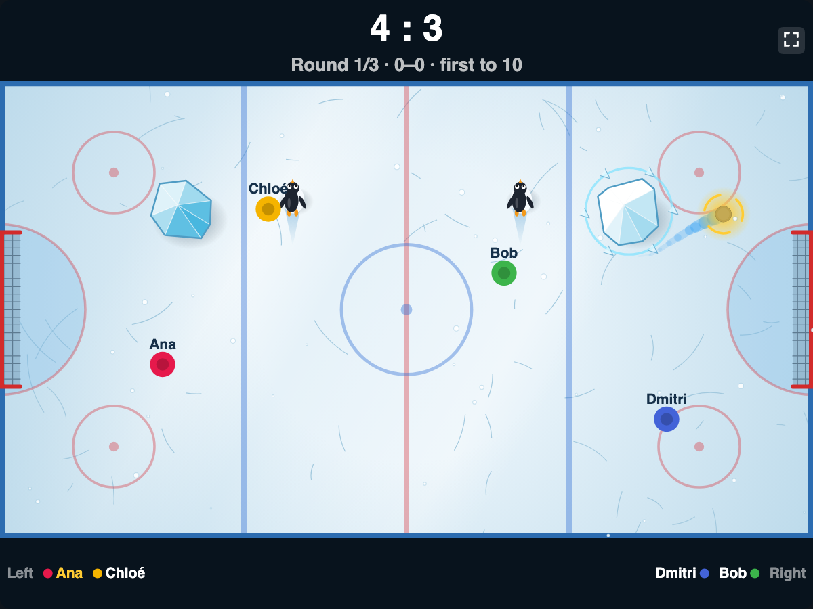
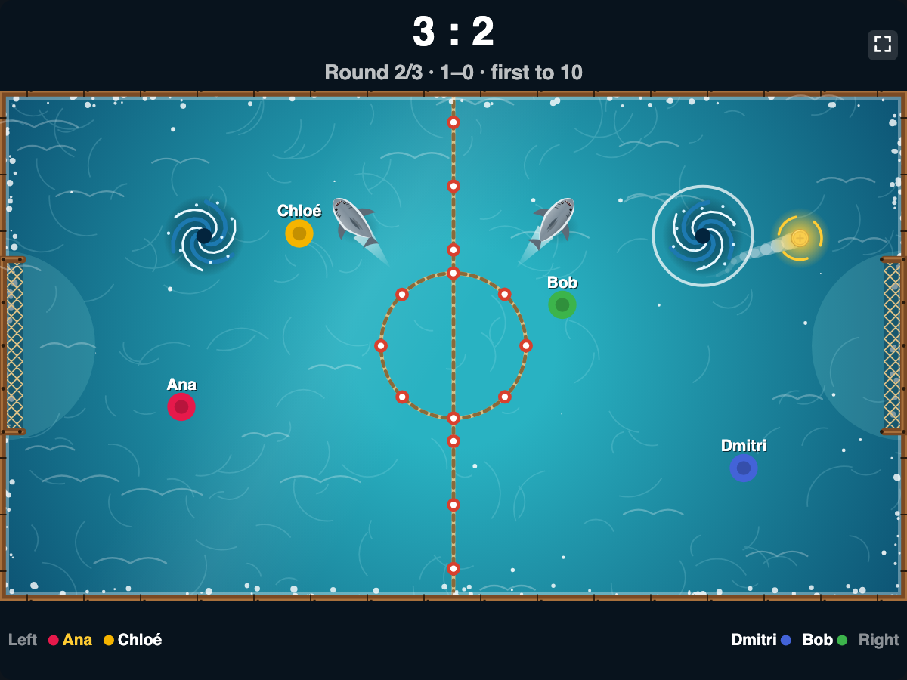
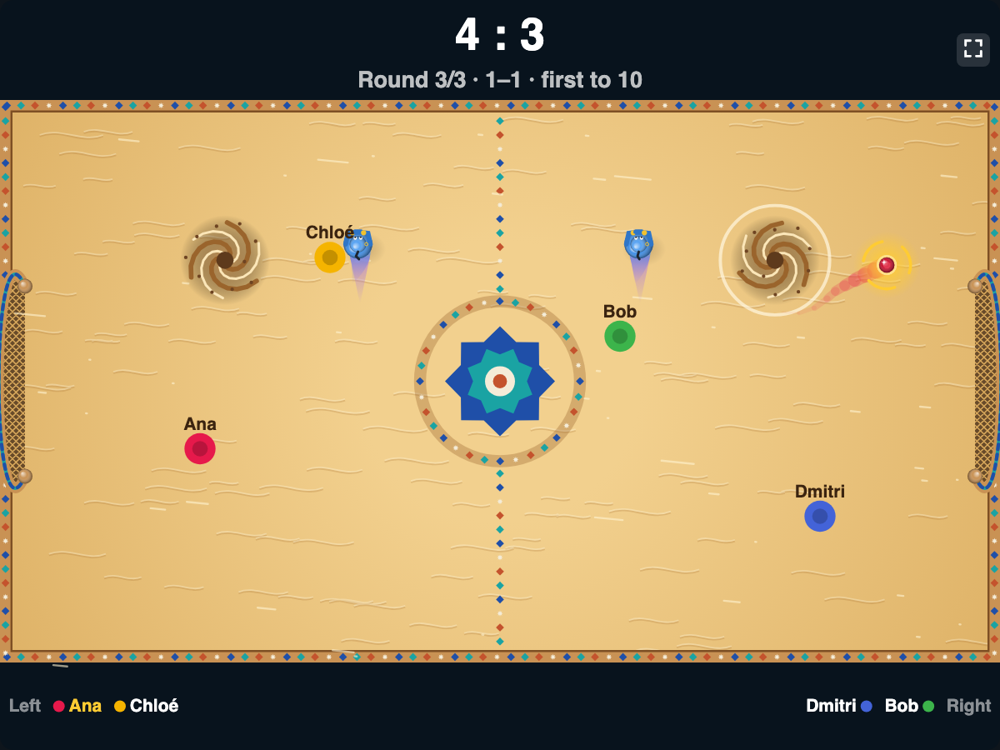

# air-hockey

[](https://www.npmjs.com/package/air-hockey)
[](https://www.npmjs.com/package/air-hockey)
[](https://bundlephobia.com/package/air-hockey)
[](https://github.com/korial29/air-hockey/actions/workflows/ci.yml)
[](package.json)
[](LICENSE)
[](https://korial29.github.io/air-hockey/)

A multiplayer air hockey game for the browser, written in TypeScript with no game library and no runtime dependency. Players join with a name, get a colour of their own, and play in teams through three scenes, one per round: an ice rink with icebergs and sliding penguins, the sea with vortices and sharks, and an Arabian Nights desert with whirlwinds and genies. Every hit, bounce, goal and spell has its sound, synthesised in the browser.

Up to 16 players, comfortable at 8: the rink grows with the players, clears its obstacles when it gets crowded, and the client compensates for network lag.







## Framework-agnostic, light to add

`airHockey()` mounts the game into any element, inside its own Shadow DOM: React, Vue, Angular, Svelte or a plain page, nothing leaks in or out. Everything is drawn on one canvas and every sound is synthesised with Web Audio: no images, fonts, audio files or other assets to serve.

| Entry | What it is | Size (gzip) |
| --- | --- | --- |
| `air-hockey` | The game client: rendering, input, prediction, sound | ~18.6 KB |
| `air-hockey/local` | Same-browser multiplayer, no server | ~6.9 KB |
| `air-hockey/server` | Node WebSocket server (needs `ws`) | Node only |
| `air-hockey/room` | One game, for any transport you already have (Socket.io…) | Node only |

The budgets (20 KB and 8 KB) are checked in CI on every pull request.

## Live demo

https://korial29.github.io/air-hockey/

Open the page in two or more tabs of the same browser, pick a name in each, and play. Add `?goals=2` to the first tab's URL for short rounds.

---

## Installation

```sh
npm install air-hockey
```

The server entry also needs [`ws`](https://github.com/websockets/ws), an optional peer dependency:

```sh
npm install ws
```

---

## Basic usage

### Tabs of the same browser, no server

```ts
import { airHockey } from 'air-hockey';
import { localSocket } from 'air-hockey/local';

const game = airHockey(document.getElementById('game')!, {
  name: 'Ana',
  socket: localSocket('my-room'),
});
```

Every tab that opens `localSocket('my-room')` joins the same game over a [`BroadcastChannel`](https://developer.mozilla.org/en-US/docs/Web/API/BroadcastChannel). One tab hosts the match, elected with [`navigator.locks`](https://developer.mozilla.org/en-US/docs/Web/API/Web_Locks_API); when it closes, another tab takes over. `navigator.locks` needs a secure context: on `http://` from a LAN address, each tab plays alone.

### Across devices, with a WebSocket server

```ts
// server.ts (Node)
import { serve } from 'air-hockey/server';

const stop = serve({ port: 8787 }); // or serve({ server: existingHttpServer })
```

```ts
// in the browser
import { airHockey } from 'air-hockey';

airHockey(document.getElementById('game')!, {
  name: 'Ana',
  url: 'wss://your-host.example/my-room',
});
```

One room per URL path: `/my-room` and `/other` are two separate games. A ready-made server ships as a command:

```sh
PORT=8787 npx air-hockey-server
```

### Over a transport you already have

An app that already talks to its server (Socket.io, an existing WebSocket, a worker) can carry the game itself. On the server, drive a `Room` from `air-hockey/room`, which needs no `ws`. On the client, pass a `socket` that relays the same frames:

```ts
// server: one Room per game, fed the frames of each peer
import { Room } from 'air-hockey/room';

const room = new Room({ goals: 3 });
room.start();
const conn = { send: (data: string | ArrayBuffer) => peer.emit('game', data) };
room.connect(conn);
peer.on('game', (data: string | ArrayBuffer) => room.receive(conn, data));
peer.on('disconnect', () => room.disconnect(conn)); // room.stop() once nobody is left
```

```ts
// client: a SocketLike over the same channel
airHockey(el, {
  name: 'Ana',
  socket: {
    binaryType: 'arraybuffer',
    onopen: null,
    onclose: null,
    onmessage: null,
    send: data => io.emit('game', data),
    close: () => io.emit('leave'),
  },
}); // then call its onopen() once the server has the peer, and onmessage({ data }) per frame
```

Text frames are JSON (`join`, and a `ping` every 2 s the room answers with a `pong`: forward both); binary frames (inputs, snapshots) must reach the room as an `ArrayBuffer` of exactly their bytes. Cap what a peer may send: inputs are 5 bytes, a join or a ping a few dozen.

### Sizing

The simplest is to give the game a box and let it fill it: with `fill: true` the container sets both the width and the height, and the game draws the rink as big as it fits in it. In a box wider than it is tall (a page on a laptop, under a header) the score and the rosters go beside the rink, which then takes the full height.

```ts
airHockey(el, { name: 'Ana', socket, fill: true });
```

```css
#game {
  width: 100%;
  height: calc(100dvh - 64px); /* whatever the page leaves */
}
```

Without `fill`, the game fills the width of its container and keeps its aspect ratio (4:3, score band and rosters included). Give the container a width; to fit a screen, cap it by the height too:

```css
#game {
  max-width: calc((100dvh - 100px) * 4 / 3);
  margin: 0 auto;
}
```

On a landscape screen at most 500 px high (a phone on its side) the game switches to a wide frame, 2430 × 1125 (about 2.16:1): the rink fills the height, the score and the rosters go beside it. Let the container grow to that ratio there:

```css
@media (orientation: landscape) and (max-height: 500px) {
  #game {
    max-width: calc(100dvh * 2430 / 1125);
  }
}
```

A mute button and a full-screen button sit in the top-right corner of the game (bottom-right in the wide frame). In full screen a phone turns landscape where the browser allows it; held upright, it shows a hint to turn it.

### Sound

Every action has a sound: your hits and the others', bounces off the boards, each kind of obstacle, a break, a splash, a genie's spell, the countdown, a goal for or against your team, a round or a match won or lost, a player joining. Browsers keep audio locked until the page is used, so the game stays silent until the first click or touch on it. Muting is remembered per browser; `sound: false` turns it all off and hides the button.

---

## API

### `airHockey(container, options)`

Mounts the game and joins. Returns `{ on, destroy }`.

| Option | Type | Default | Description |
| --- | --- | --- | --- |
| `name` | `string` | — | Player name shown above the paddle (16 characters max). A taken name gets a suffix (`Bob 2`). |
| `url` | `string` | — | WebSocket URL, room in the path. Ignored when `socket` is given. |
| `socket` | `SocketLike` | — | Any WebSocket-like object, e.g. `localSocket('room')`. |
| `fullscreen` | `boolean` | `true` | Show the full-screen button (hidden anyway where the browser does not allow it). |
| `fill` | `boolean` | `false` | Fill the container (give it a width and a height): the rink is drawn as big as it fits, the score bands on the sides when the container is height-bound. |
| `sound` | `boolean` | `true` | Synthesised sound effects (no files) and their mute button. |

### Events

`on(event, callback)` returns a function that removes the listener.

| Event | Payload | When |
| --- | --- | --- |
| `open` | — | Connected. |
| `close` | — | Disconnected. |
| `roster` | `{ you, players }` | A player joined or left. `players` are `{ id, name, color, team }`. |
| `score` | `[left, right]` | The score of the round changed. |
| `goal` | `{ team, score }` | A goal was scored. |
| `match` | `MatchState` | The phase changed: `wait`, `ready` (countdown), `play`, `break`, `end`. `break` and `end` carry the winner and the full ranking. |

```ts
game.on('match', m => {
  if (m.phase === 'end') saveResults(m.ranking);
});
```

### `destroy()`

Leaves the game, stops rendering, removes every listener and the game's DOM. Safe to call twice.

### `localSocket(room, rules?)` — `air-hockey/local`

A same-browser socket for `airHockey`. `rules` apply to the match the tab hosts: pass the same ones from every tab.

### `serve({ port | server, rules? })` — `air-hockey/server`

Starts the WebSocket server and returns an async `stop()`. `rules` apply to every room.

### `new Room(rules?)` — `air-hockey/room`

One game. `start()` and `stop()` run its clock; `connect(conn)`, `receive(conn, data)` and `disconnect(conn)` feed it a peer and its frames, and it answers through `conn.send(data)`. `size` is the number of joined players.

---

## Rules

Every field is optional; missing ones keep their default.

| Rule | Default | Description |
| --- | --- | --- |
| `arena` | `['ice', 'sea', 'desert']` | Scene, or scenes taking turns from one round to the next: `'ice'`, `'sea'`, `'desert'`, `'classic'` (empty rink). |
| `rounds` | `3` | Rounds in a match, all of them played, one scene each: the team that wins the most wins the match. |
| `goals` | `5` | Goals that win a round. |
| `hit` | `1` | Points for a hit, when the previous toucher was someone else. |
| `goal` | `20` | Points for the scorer of a goal. |
| `ownGoal` | `10` | Points taken from the last toucher of an own goal. |
| `roundWin` | `10` | Points for each player of the team that wins a round. |
| `matchWin` | `30` | Points for each player of the team that wins the match. |
| `headStart` | `1` | Uneven teams: goals the smaller team starts each round with, per missing player. |
| `readySec` | `3` | "3, 2, 1, PLAY!" countdown before each round (`0` turns it off). |
| `breakSec` | `3` | Pause between rounds. |
| `endSec` | `15` | Time the final podium stays on screen. |

```ts
serve({ port: 8787, rules: { arena: 'sea', goals: 5, rounds: 1 } });
```

---

## How a match plays

- **Teams**: players are spread left and right as they join, each with a paddle in their half. Up to 16 players.
- **The rink grows with the players**, so everybody keeps the same room: ×1 up to 3 players, ×1.15 at 4, ×1.41 at 6, ×1.63 at 8, ×2 from 12.
- **The more players, the fewer obstacles**: 8 minus the number of players, from 7 for a player alone down to none from 8 players on, when the rink is busy enough. The rink adapts while waiting, at round start and at every serve until someone touches the puck.
- **Three scenes, one per round**: ice, sea, desert.
- **Obstacles bounce the puck like pinball bumpers**, except those that grab it. Icebergs, vortices and whirlwinds stand in front of the goals, each on a random square of a grid there, every game and every round: one side's in the top half, the other's in the bottom half. They break after 3 hits and come back on another square. Penguins cross the width and are shot out on the first hit. Genies float at random along their lane and never go: a genie hit makes the puck vanish, served again in front of the shooter's opponents, and the genie stops to strike the shooter with lightning, a bolt between them, a countdown on the paddle: both stand still for 5 s, then the genie floats on. One victim at a time: a genie under its spell bounces the puck. Everything comes back after 10 s, with a ghost for the last 3 s.
- **Some obstacles grab the puck.** A whirlwind spins it round for about a second and flings it out in a random direction. A vortex sucks it under the water and lets it up, at rest, somewhere else on the rink. A shark, zig-zagging across the width, eats it and spits it out in a random direction; sharks are never shot out. A puck that comes up splashes and pops back to its size.
- **One goalie per crease**: in the half-disc marked in front of each goal, only the defender nearest the goal stops the puck. The other defenders in it turn see-through and the puck goes through them, so a wall of paddles cannot shut a goal.
- **Serves**: a served puck ignores obstacles until a player touches it, and is never served under a paddle.
- **End of match**: a stadium screen with the winning team's cup, a podium of the top scorers and the points ranking.

---

## Features

- [x] Multiplayer over WebSocket, or between tabs of one browser with no server
- [x] Unique colour per player, name above the paddle, team rosters
- [x] Teams, 3-round matches (one scene each), individual points ranking, podium screen
- [x] One goalie per crease: no wall of defenders in front of a goal
- [x] Three scenes taking turns, each with its own play: ice (icebergs, sliding penguins), sea (vortices that swallow the puck, zig-zagging sharks that spit it out, wooden goals), Arabian Nights desert (whirlwinds that catch and fling the puck, wandering genies whose lightning paralyses the shooter, Moorish arches)
- [x] Breakable obstacles with respawn and ghost
- [x] Rink that grows with the number of players, fewer obstacles as it fills, none from 8 players
- [x] Client-side prediction: your paddle and the puck react at once
- [x] Lag compensation: the round trip is measured, the puck drawn where the host has it now, inputs sent on the pointer event
- [x] Synthesised sound for every action, with a mute button, no audio files
- [x] `fill` mode: the rink as big as the page's box allows
- [x] "3, 2, 1, PLAY!" countdown, goal flash, puck beacon and trail
- [x] Full-screen button, mouse and touch, phone-sized screens: thumb-sized paddles, the rink full height on a phone on its side (score and rosters beside it), landscape in full screen, a hint to turn a phone held upright
- [x] Shadow DOM, zero runtime dependencies, size-gated in CI

---

## Upgrading from 0.x

1.0 changes nothing in the API you call, but:

- **Your own transport** (`air-hockey/room` behind Socket.io or similar) must forward the client's `ping` text frames to the room, as it forwards `join`; the room answers each with a `pong`. Without it the game still plays, with no lag compensation.
- **Rink sizes and obstacle counts changed** for most player counts (see [How a match plays](#how-a-match-plays)).
- **Sound is on by default.** Pass `sound: false` to keep the game silent.

---

## Development

Node 24 (see `.nvmrc`).

```sh
npm install
npm start            # demo with hot reload (Vite)
npm run dev:server   # WebSocket server on :8787
npm test             # Vitest
npm run lint         # Prettier, ESLint, tsc
npm run build        # dist/: client, local, server, types
npm run size         # gzip budgets
```

The demo reads `?name=`, `?mode=local|server`, `?url=`, `?goals=`, `?rounds=` and `?arena=` (for example `desert`, or `ice,sea`) from its URL, which makes testing several players in several tabs quick.

Pull requests need one release label (`release:major`, `release:minor`, `release:patch` or `release:skip`); merging one into `master` publishes the matching npm release. See [`.github/CI.md`](.github/CI.md).

---

## License

[Apache-2.0](LICENSE)
